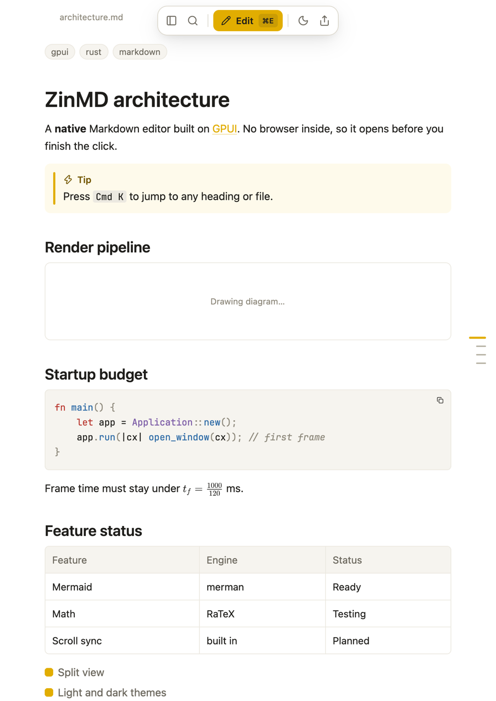

<p align="center">
  
</p>

<h1 align="center">ZinMD</h1>

<p align="center">A fast, native Markdown reader and editor for macOS, Windows and Linux.</p>

There is no browser inside. It is written in Rust on GPUI and draws
everything itself, so it opens in about 0.1 to 0.15 seconds on an Apple M4 Pro.

A file opens as a page to read, in a window the shape of a sheet of paper.
`⌘E` turns the page into the editor, and back.

<p align="center">
  
</p>


## What it does

- A page to read: nothing around the text but a menu that steps aside
- A rail down the page's edge with a mark for each heading: point at one to
  see what the section is about, click to go there
- An editor one key away: source, live preview, or both side by side, with scroll sync
- GitHub-style Markdown: tables, task lists, front matter, callouts
- LaTeX math and Mermaid diagrams, drawn natively
- Pictures and diagrams open large on a click: zoom, move, copy, save
- Words that grow with the page, a black-and-white switch for sharper
  reading, and find on the page
- Highlighted code blocks
- A side panel instead of tabs: the files you opened, then the folders you
  added, with their Markdown files. Pin a folder, drag it elsewhere, type to
  find a file in any of them, peek inside a file without opening it
- Copy a file's content or its path from its row; new, rename, move to Trash
- Command palette (`⌘P`) and search across every folder (`⇧⌘F`): what is
  found is shown a section at a time, the best first, and opens at its
  place with the words marked on the page
- Search that forgives: accents and case do not count, words are found in
  any order, and a slip of the finger still finds the word you meant
- Back and forward, as in a browser: follow a link, a heading or a search
  result, and one key takes you back to where you were
- The files before and after the one you read, as two quiet links at the
  foot of the page
- Export to one self-contained HTML file
- Picks up changes made on disk, reopens where you left off, and keeps
  unsaved work safe if the app crashes
- Updates itself: one click, and it is back on the new version
- Light and dark, with JetBrains Mono, Fira Code or Menlo in the editor

## Install

Get the file for your computer from the [latest release](https://github.com/iRbouh/ZinMD/releases/latest).

| Your computer | To install | To run without installing |
| --- | --- | --- |
| Mac with Apple Silicon | `…-macos-arm64.dmg` | `…-macos-arm64.zip` |
| Mac with an Intel processor | `…-macos-x64.dmg` | `…-macos-x64.zip` |
| Windows 10 or 11 | `…-windows-x64-setup.exe` | `…-windows-x64.zip` |
| Ubuntu, Debian, Mint | `…-linux-x64.deb` | `…-linux-x64.AppImage` |
| Fedora, openSUSE | `…-linux-x64.rpm` | `…-linux-x64.AppImage` |
| Any other Linux | `…-linux-x64.tar.gz` | `…-linux-x64.AppImage` |

The installed versions offer ZinMD for Markdown files, so a `.md` file can be
opened with it from the file manager.

ZinMD is not signed yet, so macOS and Windows ask before they open it the
first time. On macOS, choose **Open Anyway** under System Settings, Privacy &
Security. On Windows, choose **More info**, then **Run anyway**.

## Updates

ZinMD looks for a new version when it starts, and a few times a day after
that. When there is one it fetches it in the background, checks it, and then
says so on a small card at the foot of the window. **Restart** swaps the new
version in and opens it with every file as you left it, unsaved edits
included.

- The Mac app, both Windows versions, the Linux AppImage and the copy
  installed from the `.tar.gz` update themselves this way.
- A `.deb` or `.rpm` belongs to the system, so there ZinMD only says that a
  new version is out, with a link to it.
- "Check for updates" is in the command palette, and in the app's menu on
  macOS. "Stop looking for updates by itself" turns the looking off.

Looking for a new version asks GitHub for one small file. Nothing about you
or your documents is sent.

## Build

You need a recent Rust toolchain; the one it is built with is named in
`rust-toolchain.toml` and is fetched on the first build. On Linux you also need
the libraries a window is made with:

```sh
sudo apt install libxcb1-dev libx11-xcb-dev libxkbcommon-dev libxkbcommon-x11-dev \
  libwayland-dev libfontconfig1-dev libfreetype6-dev libssl-dev pkg-config
```

```sh
# Run it on a file or a folder
cargo run --release -- path/to/notes.md

# macOS: make the app, target/ZinMD.app
./scripts/bundle.sh
```

The `samples` folder has a few documents to try it with.

## Releases

Pushing a tag makes a release: `git tag v0.2.0 && git push origin v0.2.0`,
with the same number in `Cargo.toml`. GitHub then builds every download in
the table above, tries each one the way a person would (installs it, opens a
document, updates it, removes it), and attaches them to a new release, with
the list that tells the copies already out there that it exists. A tag with a dash
in it, such as `v0.2.0-rc.1`, makes a pre-release.

The same can be done by hand, on the system in question:

| System | Build the downloads | Try them |
| --- | --- | --- |
| macOS | `scripts/package-macos.sh arm64` or `x64` | `scripts/try-macos.sh arm64` |
| Windows | `scripts\package-windows.ps1` | `scripts\try-windows.ps1` |
| Linux | `scripts/package-linux.sh` | `scripts/try-linux.sh` |

The files land in `dist/`.

## Shortcuts

| Keys | Action |
| --- | --- |
| `⌘E` | Read, or edit |
| `⌥↑` `⌥↓` | Previous, next section |
| `Space` `⇧Space` | On a page: down, up a screen |
| `⌘K` | Find a file in the side panel |
| `⌘\` | Show or hide the side panel |
| `⌘1` to `⌘9` | Go to a file opened on its own |
| `⌃Tab` | Back to the last file |
| `⌘[` `⌘]` | Back to where you were, and forward again |
| `⇧⌘[` `⇧⌘]` | The file before, and after, this one in its folder |
| `⇧⌘C` `⌥⌘C` | Copy the file's content, its path |
| `⌥⌘1` `⌥⌘2` `⌥⌘3` | Editor, split, preview |
| `⌘P` | Command palette |
| `⇧⌘F` | Search in all files |
| `⇧⌘E` | Export as HTML |
| `⌘+` `⌘-` `⌘0` | Text size: the page's while reading, the editor's while editing |
| `⌘F` `⌘G` `⇧⌘G` | Find on the page, next, previous |
| `⌘N` `⌘O` `⌘S` `⌘W` | New, open, save, close |

In the side panel the arrows move through the rows, Return opens one, Space
peeks inside a file, and typing starts a search.

On Windows and Linux, `Ctrl` stands in for `⌘`.

## Status

Early. The app is not signed or notarized yet, and PDF export is not built.
It is made on a Mac: the Windows and Linux versions are built and started by
the release pipeline, but have had far less use.

## Credits

Inspired by [Markdown Preview Enhanced](https://github.com/shd101wyy/vscode-markdown-preview-enhanced).
Built with [gpui-kit](https://crates.io/crates/gpui-kit),
[merman](https://crates.io/crates/merman) for diagrams and RaTeX for math.

The icon is a zellij rosette, the eight-point star and its petals from
Moroccan tile work. The drawings are in [`design/logo`](design/logo).

JetBrains Mono and Fira Code ship with the app under the SIL Open Font
License 1.1; their licence files are in `assets/fonts`.

## Licence

[MIT](LICENSE)
