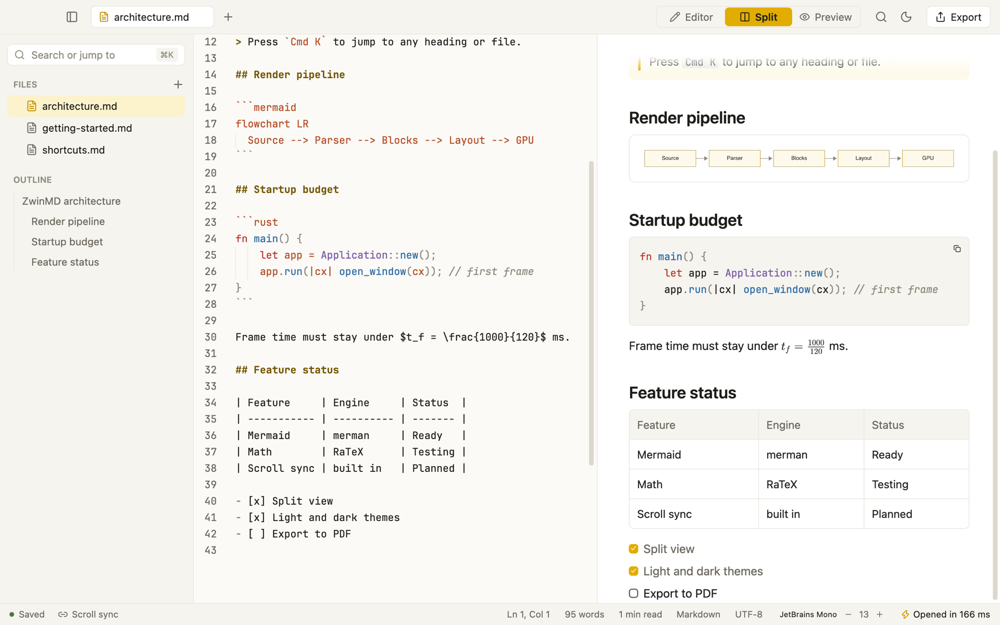

# ZwinMD

A fast, native Markdown editor and viewer for macOS.

There is no browser inside. It is written in Rust on GPUI and draws
everything itself, so it opens in about 0.1 to 0.15 seconds on an Apple M4 Pro.



## What it does

- Editor, live preview, or both side by side, with scroll sync
- GitHub-style Markdown: tables, task lists, front matter, callouts
- LaTeX math and Mermaid diagrams, drawn natively
- Highlighted code blocks
- Tabs, an outline, and a file sidebar (new, rename, move to Trash)
- Command palette (`⌘K`) and search across the whole folder (`⇧⌘F`)
- Export to one self-contained HTML file
- Picks up changes made on disk, reopens where you left off, and keeps
  unsaved work safe if the app crashes
- Light and dark, with JetBrains Mono, Fira Code or Menlo in the editor

## Build

You need macOS and a recent Rust toolchain (it is built with Rust 1.98).

```sh
# Run it on a file or a folder
cargo run --release -- path/to/notes.md

# Make the app: target/ZwinMD.app
./scripts/bundle.sh
```

The `samples` folder has a few documents to try it with.

## Shortcuts

| Keys | Action |
| --- | --- |
| `⌘1` `⌘2` `⌘3` | Editor, split, preview |
| `⌘K` or `⌘P` | Command palette |
| `⇧⌘F` | Search in all files |
| `⌘\` | Show or hide the sidebar |
| `⇧⌘E` | Export as HTML |
| `⌘+` `⌘-` `⌘0` | Editor text size |
| `⌘N` `⌘O` `⌘S` `⌘W` | New, open, save, close tab |

## Status

Early. The app is not signed or notarized yet, and PDF export is not built.

## Credits

Inspired by [Markdown Preview Enhanced](https://github.com/shd101wyy/vscode-markdown-preview-enhanced).
Built with [gpui-kit](https://crates.io/crates/gpui-kit),
[merman](https://crates.io/crates/merman) for diagrams and RaTeX for math.

JetBrains Mono and Fira Code ship with the app under the SIL Open Font
License 1.1; their licence files are in `assets/fonts`.

## Licence

[MIT](LICENSE)
