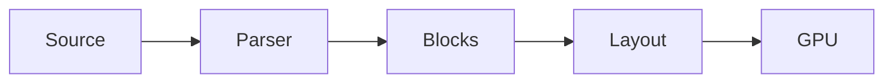

# zwinMD architecture

A **native** Markdown editor built on [GPUI](https://gpui.rs).
No browser inside, so it opens before you finish the click.

> [!TIP]
> Press `Cmd K` to jump to any heading or file.

## Render pipeline



## Startup budget

```rust
fn main() {
    let app = Application::new();
    app.run(|cx| open_window(cx)); // first frame
}
```

Frame time must stay under $t_f = \frac{1000}{120}$ ms.

## Feature status

| Feature     | Engine     | Status  |
| ----------- | ---------- | ------- |
| Mermaid     | merman     | Ready   |
| Math        | RaTeX      | Testing |
| Scroll sync | built in   | Planned |

- [x] Split view
- [x] Light and dark themes
- [ ] Export to PDF
