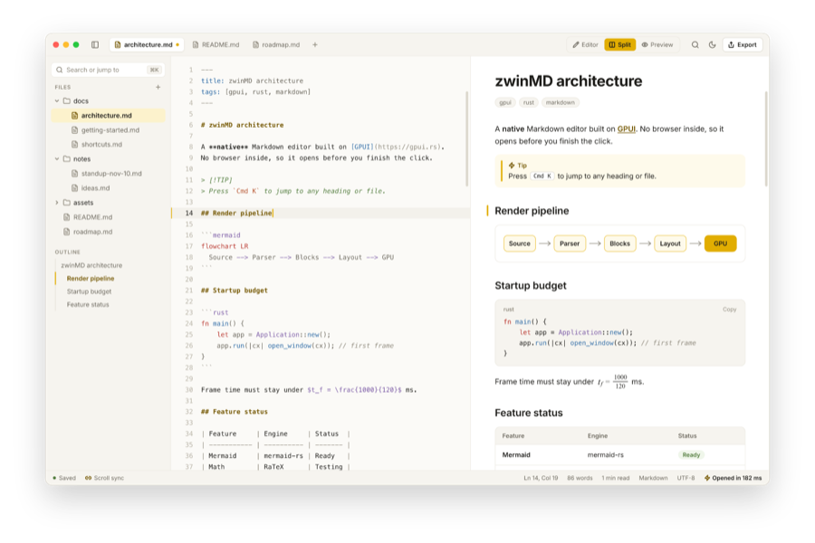

# Getting started

Open a folder with `zwinmd path/to/notes`.

## Try it

- [ ] Tick this box in the preview
- [x] Follow a link to [shortcuts](shortcuts.md) or to the [architecture](architecture.md#startup-budget)
- [ ] Jump inside this page: [back to top](#getting-started)

