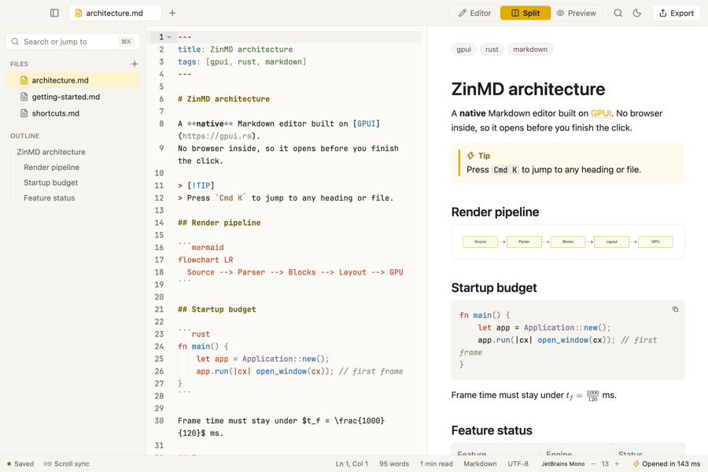
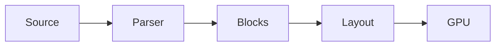
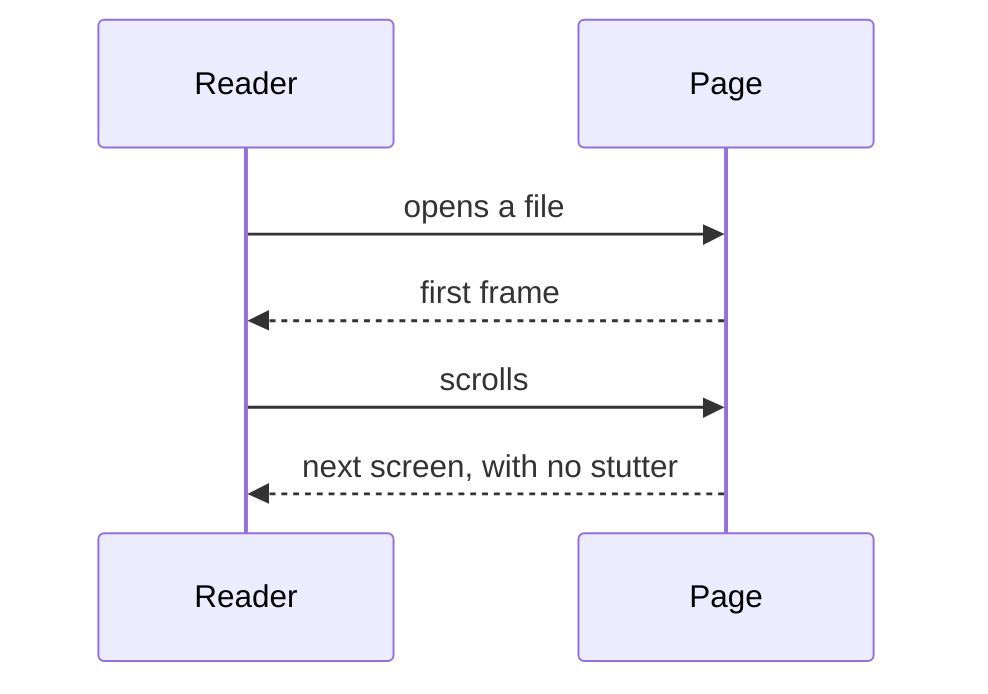
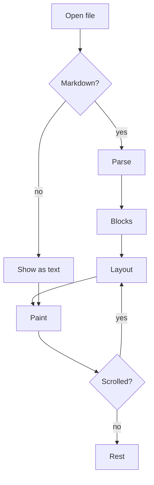

# A field guide to slow reading

Reading on a screen is tiring when the page fights you. The line is too long, the paragraphs sit on top of each other, and a heading arrives without warning. A good page gets out of the way and lets the words do the work.

This document has one of everything, so the spacing between different kinds of blocks can be judged side by side. It is long on purpose: a reading page is judged over many screens, not one.

## Paragraphs and emphasis

A paragraph should be easy to enter and easy to leave. **Strong words** stand out, *quiet emphasis* leans, and `inline code` sits in the line without pushing its neighbours apart. A [link to somewhere](https://example.com) is visible but does not shout.

A second paragraph follows the first. The gap between them tells the eye that a new thought begins, without a blank line so tall that the text falls apart into separate islands.

A short one.

### A smaller heading

Text right after a smaller heading. The heading belongs to what follows it, so it sits closer to this paragraph than to the one before.

#### The smallest heading in use

Text after the smallest heading.

## Lists

Things to pack:

- A notebook with squared paper
- Two pencils, sharpened
  - One soft, for margins
  - One hard, for the text itself
- A long list item that runs over more than one line, to see how the second line sits under the first and how far it is from the next item in the list

Steps, in order:

1. Read the page once, quickly
2. Read it again with a pencil
3. Write down what you would tell a friend

Tasks:

- [x] Choose a chair
- [x] Turn the phone over
- [ ] Begin

## Quotes and notes

> The reader's eye should travel down the page without being stopped by anything but the meaning.
>
> It is a simple rule and very hard to follow.

> [!NOTE]
> A note sits in the flow of the text and is the same width as a paragraph.

> [!TIP]
> A tip is friendlier. It uses the accent colour.

> [!WARNING]
> A warning must be seen, but should not shake the page.

## Code

A short command on its own: 

```sh
zinmd notes/field-guide.md
```

A longer block, with a long line in it:

```rust
/// Lay the page out: one block after another, each as wide as the measure.
fn lay_out(blocks: &[Block], measure: Pixels) -> Vec<Placed> {
    let mut y = px(0.);
    blocks.iter().map(|block| {
        let placed = block.place(measure, y); // a deliberately long comment that runs past the right edge of a narrow page to see what happens to it
        y += placed.height + block.gap_after();
        placed
    }).collect()
}
```

Text straight after a code block.

## Tables

| Block      | Space above | Space below | Notes                         |
| ---------- | ----------- | ----------- | ----------------------------- |
| Paragraph  | 0           | 1 line      | The unit everything hangs on  |
| Heading 2  | 2 lines     | half a line | Belongs to what follows       |
| Code       | 1 line      | 1 line      | Never wider than the measure  |
| Image      | 1 line      | 1 line      | With its caption              |

Text straight after a table.

## Pictures



Text straight after a picture.

## Diagrams



A sequence:



A bigger one, taller than it is wide:



## Maths

The frame budget is $t_f = \frac{1000}{120}$ milliseconds, inline. On its own line:

$$
\int_0^\infty e^{-x^2}\,dx = \frac{\sqrt{\pi}}{2}
$$

Text straight after the formula.

---

## The end

A last paragraph after a rule, so the foot of the document can be judged too. It ends here.
